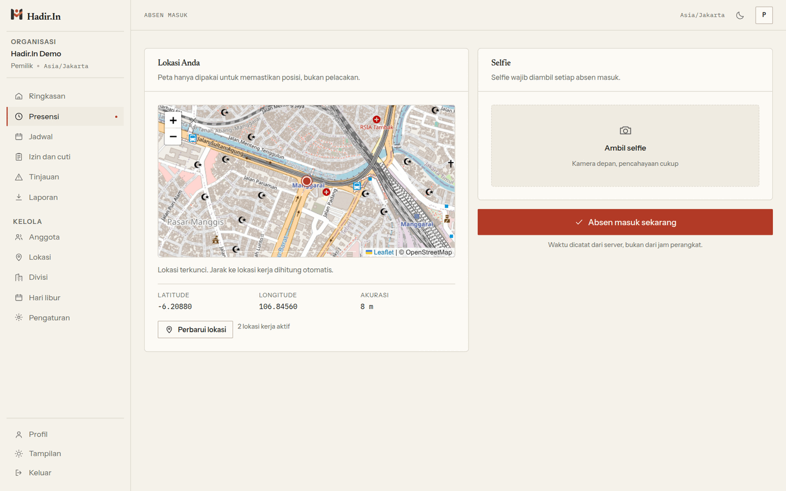
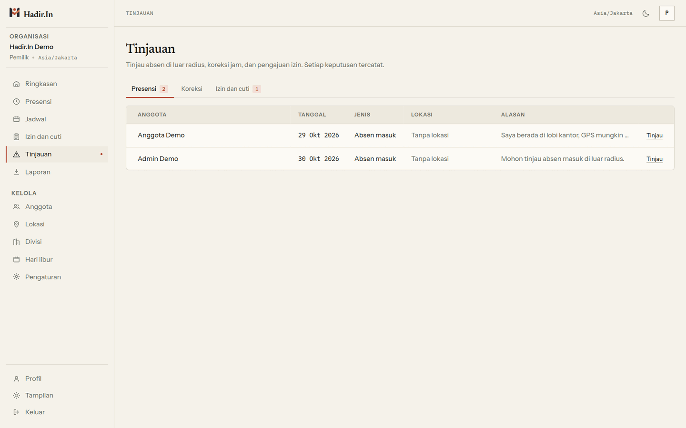
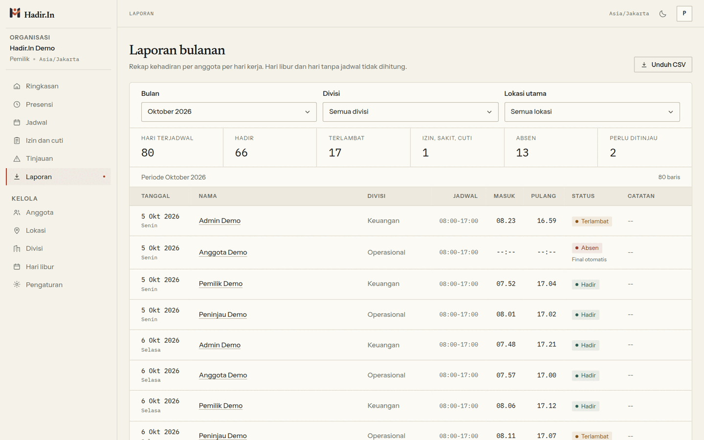
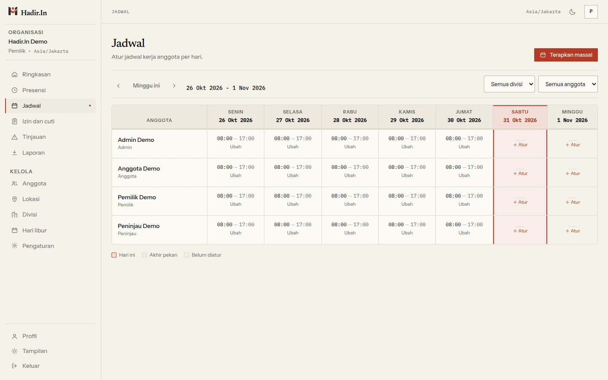
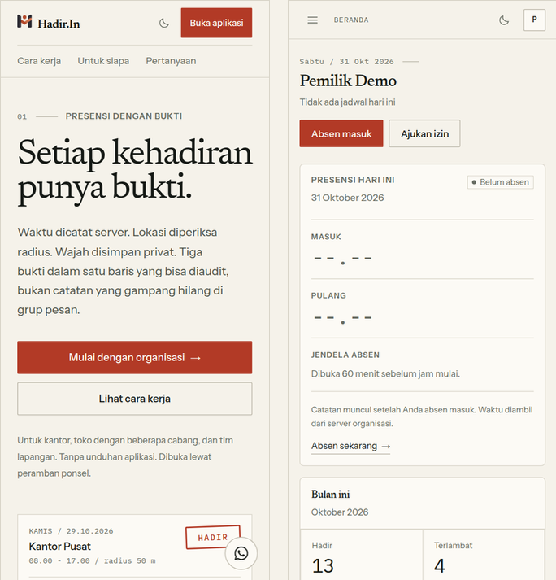
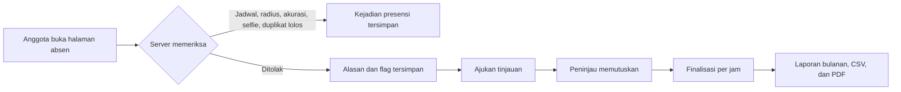

# Hadir.In

Presensi kantor dan tim lapangan dengan bukti waktu, lokasi, dan selfie.
Hadir.In mencatat kehadiran harian, jadwal kerja, izin, cuti, dan laporan
bulanan dalam satu tempat. Antarmuka berbahasa Indonesia, dengan tabel yang
tetap terbaca di layar 360 px. Halaman absen menempatkan peta, koordinat,
akurasi, dan selfie dalam satu tampilan.


Satu instalasi dapat melayani banyak organisasi. Anggota, lokasi, jadwal, dan
pengaturan dipisahkan per organisasi, sementara seorang pengguna boleh menjadi
anggota di beberapa organisasi tanpa mencampur data.

## Status

- Alur v1 lengkap dan 262 pengujian Pest lulus dengan 903 asersi.
- Sebelum go-live masih ada dua uji di luar mesin pengembangan: kamera dan GPS
  di perangkat nyata (`docs/TESTING.md` bagian 9), serta migrasi dan pengujian
  di staging PostgreSQL.
- Kode belum memiliki lisensi terbuka. Hak penggunaan belum ditetapkan.

## Tampilan

Semua tangkapan layar memakai data seeder demo.


| Dasbor | Absen masuk |
| :---: | :---: |
| [](docs/media/readme/dashboard.png) | [](docs/media/readme/check-in.png) |
| Waktu server, antrean tinjauan, dan ringkasan bulan berjalan. | Peta, koordinat, akurasi GPS, dan selfie di satu halaman. |

| Tinjauan | Laporan |
| :---: | :---: |
| [](docs/media/readme/review.png) | [](docs/media/readme/reports.png) |
| Absen di luar radius dan koreksi jam, dengan nilai asli tetap tersimpan. | Ringkasan bulanan, rincian harian, filter divisi dan lokasi, ekspor CSV dan PDF. |

| Jadwal | Tampilan ponsel |
| :---: | :---: |
| [](docs/media/readme/schedule.png) | [](docs/media/readme/mobile-pair.png) |
| Jadwal per anggota per tanggal, penerapan massal, dan hari libur. | Beranda publik dan dasbor anggota pada lebar 390 px. |

## Fitur

### Organisasi dan akses

- Pendaftaran organisasi baru dengan pemilik sebagai anggota pertama.
- Aktivasi oleh platform admin sebelum organisasi bisa dipakai.
- Undangan sekali pakai melalui tautan bercadangan token.
- Empat peran di dalam organisasi: pemilik, admin, peninjau, anggota.
- Perpindahan antar organisasi untuk pengguna dengan beberapa keanggotaan.
- Platform admin mengelola daftar organisasi, status, paket, dan penangguhan,
  dan tidak dapat melihat data presensi, selfie, atau detail anggota.

### Presensi

- Absen masuk dan absen pulang satu kali per anggota per hari kerja.
- Jam yang dicatat adalah jam server, bukan jam ponsel. Server menyimpan waktu
  dalam UTC, tanggal kerja mengikuti zona waktu organisasi.
- Geofence per lokasi kerja: radius lokasi ditambah buffer (default 50 m).
  Masuk radius tanpa masuk radius asli tetap diterima dengan tanda.
- Akurasi GPS: di atas ambang organisasi (default 100 m) diterima dengan tanda
  "Akurasi rendah". Di atas 500 meter ditolak karena koordinat tidak dapat
  dipercaya (BR-88).
- Selfie wajib atau opsional per organisasi. Berkas disimpan di disk privat,
  metadata EXIF termasuk GPS dihapus saat pemrosesan, dan dibuka lewat signed
  URL yang berlaku 5 menit.
- Penolakan menyimpan alasan dan kode flag. Anggota dapat mengajukan tinjauan
  untuk kejadian yang ditolak.

### Jadwal, hari libur, izin

- Jadwal per anggota per tanggal dengan jendela absen masuk.
- Penerapan massal hingga 92 hari, dengan pengecualian hari libur.
- Hari libur organisasi memblokir jadwal dan absen pada tanggal itu.
- Pengajuan izin, sakit, dan cuti. Persetujuan memblokir absen masuk pada
  tanggal yang disetujui. Pengajuan dapat dibatalkan sebelum diputuskan.

### Tinjauan, koreksi, laporan

- Antrean tinjauan untuk absen di luar radius dan koreksi jam.
- Koreksi menyimpan nilai asli, nilai yang diminta, dan catatan keputusan.
  Data presensi tidak pernah dihapus (BR-87).
- Laporan bulanan dengan filter divisi dan lokasi, rincian per anggota, dan
  ekspor CSV serta PDF A4 lanskap sebagai bukti kehadiran untuk stakeholder.

## Cara kerja

1. Anggota membuka halaman absen. Peta menunjukkan posisi, radius tiap lokasi
   kerja, dan akurasi GPS. Selfie diambil dari kamera perangkat.
2. Server memeriksa jadwal, radius, akurasi, selfie, dan duplikasi. Penolakan
   menyimpan alasan dan dapat diajukan tinjauan.
3. Peninjau atau admin memutuskan antrean. Koreksi menyimpan nilai asli dan
   catatan keputusan.
4. Finalisasi berjalan setiap jam. Hari kerja tanpa absen menjadi `absen`, dan
   laporan bulanan siap diunduh sebagai CSV.



## Arsitektur

| Bagian | Pilihan |
| --- | --- |
| Framework | Laravel 12, PHP 8.2+ |
| Antarmuka | Livewire 3, Tailwind CSS 4, Vite 7 |
| Database | PostgreSQL 16 di produksi, SQLite untuk pengujian |
| Pengujian | Pest 3 |
| Bahasa | Antarmuka Indonesia, kode dan nama kelas Inggris |

Prinsip yang berlaku di seluruh kode:

- **Tenancy.** Semua model tenant memakai trait `BelongsToTenant` dengan global
  scope yang membaca `TenantContext`. Query tenant tanpa konteks tidak
  mengembalikan data. `withoutGlobalScopes` hanya boleh dipakai di panel
  platform dan job sistem dengan komentar alasan.
- **Controller tipis.** Logika bisnis ada di `app/Services` (AttendanceService,
  GeofenceService, SelfieService, FinalizationService, LeaveService,
  ScheduleService, ReportService, InvitationService, TenantService,
  TenantClock). Status memakai enum PHP di `app/Enums`.
- **Keamanan.** Login dibatasi 5 percobaan per menit per email dan IP (BR-82).
  Sesi memakai driver database dan sejak November 2026 terenkripsi dengan
  cookie `secure` aktif secara default. Semua form memakai CSRF, akses data
  lewat policy (BR-84). Selfie tidak pernah lewat disk publik.
- **Jejak perubahan.** Setiap aksi presensi menulis `attendance_events` atau
  `attendance_corrections`. Tidak ada penghapusan riwayat.

## Aturan bisnis kunci

| Kode | Aturan |
| --- | --- |
| BR-24 | Akurasi GPS di atas 100 meter dicatat dengan tanda "Akurasi rendah" |
| BR-82 | Login dibatasi 5 percobaan per menit per email dan IP |
| BR-84 | CSRF di semua form, akses data lewat policy |
| BR-87 | Data presensi tidak dihapus, retensi hanya menghapus berkas selfie |
| BR-88 | Akurasi GPS di atas 500 meter menolak presensi |

Daftar lengkap ada di `docs/PRD.md` bagian 8.

## Menjalankan secara lokal

Prasyarat: PHP 8.2+ dengan ekstensi `pdo_sqlite`, `gd`, `mbstring`, `fileinfo`,
`zip`; Composer 2; Node 20+; npm.

```bash
composer install
npm install
cp .env.example .env
php artisan key:generate
touch database/database.sqlite
php artisan migrate --seed
npm run build
php artisan serve
```

Buka `http://127.0.0.1:8000`, lalu masuk dengan salah satu akun demo di bawah.
`.env.example` sudah memakai SQLite, jadi tidak perlu memasang PostgreSQL.

Aset harus dibangun sebelum halaman dibuka. Tanpa `npm run build` atau
`npm run dev`, Laravel gagal memuat manifest Vite dan setiap halaman
mengembalikan galat 500.

Saat mengembangkan tampilan, jalankan dua proses di dua terminal:

```bash
npm run dev        # terminal 1, biarkan berjalan
php artisan serve  # terminal 2
```

`npm run dev` berjalan terus dan tidak selesai sendiri, jadi jangan
menjalankannya dalam satu blok berurutan dengan `php artisan serve`.

### Menguji kamera dan GPS dari ponsel

Browser hanya memberi izin kamera dan lokasi pada konteks aman.
`http://127.0.0.1` dihitung aman, tetapi alamat IP LAN seperti
`http://192.168.1.10:8000` tidak. Untuk uji di ponsel, pakai terowongan HTTPS
(misalnya `cloudflared tunnel --url http://localhost:8000`) dan buka alamat
HTTPS yang diberikan.

### PostgreSQL

Ganti blok `DB_*` di `.env` dengan contoh yang sudah dikomentari di berkas itu,
dan pastikan ekstensi `pdo_pgsql` aktif. Bila ekstensi belum ada,
`docs/OPERATIONS.md` bagian 16 menjelaskan cara memasangnya tanpa akses root.

`php artisan test` memakai SQLite dari `phpunit.xml`. Untuk menguji
kompatibilitas PostgreSQL, jalankan dengan variabel lingkungan:

```bash
DB_CONNECTION=pgsql DB_HOST=127.0.0.1 DB_PORT=5432 \
DB_DATABASE=hadir_test DB_USERNAME=hadir DB_PASSWORD=... \
php artisan test
```

Tanpa itu, keluaran hijau hanya membuktikan SQLite.

## Akun demo

Setelah `php artisan migrate --seed`, seeder demo membuat organisasi
"Hadir.In Demo" dengan kata sandi `password123` untuk semua akun:

| Peran | Email |
| --- | --- |
| Pemilik | `pemilik@hadir.test` |
| Admin | `admin@hadir.test` |
| Peninjau | `peninjau@hadir.test` |
| Anggota | `anggota@hadir.test` |
| Platform admin | `platform@hadir.test` |

Seeder demo hanya berjalan di lingkungan `local` dan `testing`, dan aman
dijalankan berulang.

## Perintah penting

```bash
php artisan test                 # seluruh pengujian
php artisan test --filter=CheckInTest
./vendor/bin/pint                # format PHP
npm run build                    # build aset produksi
npm run design:lint              # periksa DESIGN.md terhadap skema token
php artisan migrate:fresh --seed # reset database lokal
php artisan schedule:work        # jalankan penjadwal di lokal
php artisan queue:work           # jalankan worker antrean di lokal
```

Perintah khusus aplikasi, dijalankan penjadwal di produksi:

| Perintah | Jadwal | Fungsi |
| --- | --- | --- |
| `attendance:finalize` | Setiap jam | Menutup hari kerja yang lewat batas dan menandai absen |
| `selfies:purge` | Harian 02:00 | Menghapus berkas selfie yang melewati masa retensi |
| `model:prune` | Harian 03:00 | Memangkas model dengan trait `Prunable` |

## Struktur kode

```
app/
  Console/Commands/   Perintah artisan (finalisasi, pembersihan selfie)
  Enums/              Status dan peran sebagai enum PHP
  Http/Controllers/   Controller tipis untuk auth, publik, platform, ekspor
  Livewire/           Halaman aplikasi: attendance, dashboard, members,
                      schedules, leave, reviews, reports, settings, platform
  Models/             14 model Eloquent dengan trait BelongsToTenant
  Policies/           Otorisasi per model
  Services/           Logika bisnis presensi, geofence, selfie, laporan
  Support/            TenantContext, Reasons, Flags, TenantClock, helper
resources/
  views/livewire/     Blade per halaman Livewire
  views/components/   Layout app, auth, platform, public dan komponen
  css/  js/           Tailwind dan JS (peta Leaflet, tema, konfirmasi)
docs/                 Dokumen produk, arsitektur, database, operasi
database/migrations/  Skema PostgreSQL dan SQLite
tests/                Pest: Unit dan Feature per modul
```

Peta rute lengkap ada di `docs/ROUTES.md`, skema tabel ada di
`docs/DATABASE.md`.

## Struktur dokumentasi

Baca berurutan bila baru membuka repositori:

| Berkas | Isi |
| --- | --- |
| `docs/PRD.md` | Masalah, pengguna, ruang lingkup, aturan bisnis, kriteria penerimaan |
| `DESIGN.md` | Spesifikasi visual kanonik: token, komponen, pola layar |
| `docs/ARCHITECTURE.md` | Batas modul, tenancy, alur data, antrean, penyimpanan |
| `docs/DATABASE.md` | Skema tabel, indeks, relasi, dan arti status |
| `docs/ROUTES.md` | Peta rute, nama rute, middleware, dan komponen |
| `docs/TESTING.md` | Strategi pengujian dan daftar kasus kritis |
| `docs/OPERATIONS.md` | Lingkungan, deployment, backup, pemantauan, pemecahan masalah |
| `docs/ROADMAP.md` | Urutan milestone dan kriteria selesai |
| `docs/DECISIONS.md` | Catatan keputusan arsitektur dan alasannya |
| `docs/README.md` | Peta dokumen dan urutan prioritas bila dokumen bertentangan |
| `AGENTS.md` | Aturan kerja untuk agen AI dan kontributor manusia |

Bila dokumen bertentangan, urutan prioritasnya ada di `AGENTS.md` dan
`docs/README.md`.

## Batas v1

- Tidak ada aplikasi native, absensi offline, pengenalan wajah, payroll, atau
  API publik.
- Selfie bukan verifikasi identitas. Tidak ada liveness detection.
- Data presensi tidak dihapus. Retensi selfie diatur per organisasi (7-365
  hari, default 90) dan hanya menghapus berkas, bukan catatan absen.
- Uji kamera dan GPS di perangkat nyata serta uji staging PostgreSQL belum
  dijalankan. Keduanya wajib sebelum go-live.

Rincian kasus uji ada di `docs/TESTING.md` bagian 5 dan 9.

## Lisensi

Kode belum memiliki lisensi terbuka. Hak penggunaan belum ditetapkan.
