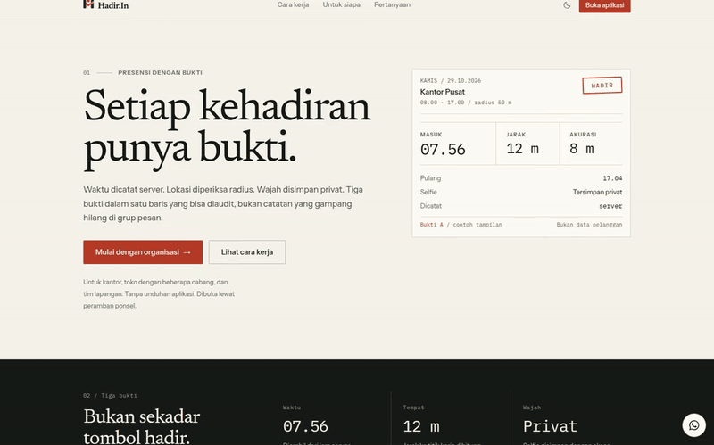
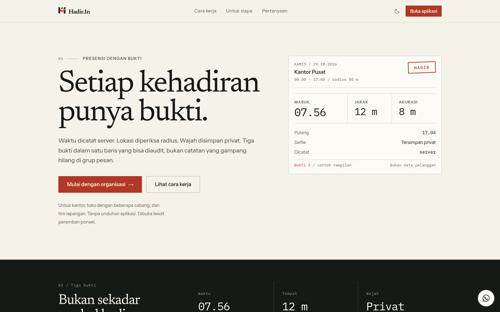
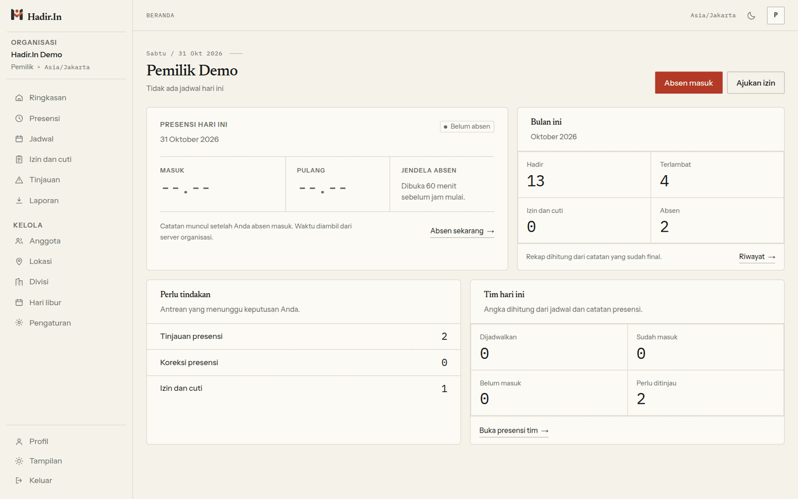

# Hadir.In

Presensi kantor dan tim lapangan dengan bukti waktu, lokasi, dan selfie.
Hadir.In mencatat kehadiran harian, jadwal kerja, izin, cuti, dan laporan bulanan
dalam satu tempat. Antarmuka berbahasa Indonesia, dengan tabel yang tetap terbaca
di layar 360 px. Halaman absen menempatkan peta, koordinat, akurasi, dan selfie
dalam satu tampilan.



Satu instalasi dapat melayani banyak organisasi. Anggota, lokasi, jadwal, dan
pengaturan dipisahkan per organisasi, sementara seorang pengguna boleh menjadi
anggota di beberapa organisasi tanpa mencampur data.

Alur v1 sudah lengkap: 196 tes Pest lulus dengan 717 asersi. Sebelum go-live,
masih ada dua uji yang harus dijalankan di luar mesin pengembangan: kamera dan
GPS di perangkat nyata (`docs/TESTING.md` bagian 9), serta migrasi dan pengujian
di staging PostgreSQL.

## Tampilan

Semua tangkapan layar memakai data seeder demo.



| Dasbor | Absen masuk |
| :---: | :---: |
| [](docs/media/readme/dashboard.png) | [](docs/media/readme/check-in.png) |
| Waktu server, antrean tinjauan, dan ringkasan bulan berjalan. | Peta, koordinat, akurasi GPS, dan selfie di satu halaman. |

| Tinjauan | Laporan |
| :---: | :---: |
| [](docs/media/readme/review.png) | [](docs/media/readme/reports.png) |
| Absen di luar radius dan koreksi jam, dengan nilai asli tetap tersimpan. | Ringkasan bulanan, rincian harian, filter divisi dan lokasi, ekspor CSV. |

| Jadwal | Tampilan ponsel |
| :---: | :---: |
| [](docs/media/readme/schedule.png) | [](docs/media/readme/mobile-pair.png) |
| Jadwal per anggota per tanggal, penerapan massal, dan hari libur. | Beranda publik dan dasbor anggota pada lebar 390 px. |

## Cara kerja

1. Anggota membuka halaman absen. Peta menunjukkan posisi, radius tiap lokasi
   kerja, dan akurasi GPS. Selfie diambil dari kamera perangkat.
2. Server memeriksa jadwal, radius, akurasi, dan duplikasi. Waktu yang dipakai
   adalah jam server, bukan jam ponsel. Penolakan menyimpan alasan dan dapat
   diajukan tinjauan.
3. Peninjau atau admin memutuskan antrean. Koreksi menyimpan nilai asli, nilai
   yang diminta, dan catatan keputusan.
4. Finalisasi berjalan setiap jam. Hari kerja tanpa absen menjadi `absen`, dan
   laporan bulanan siap diunduh sebagai CSV.

## Yang sudah berjalan

| Area | Isi |
| --- | --- |
| Organisasi dan akses | Pendaftaran organisasi, aktivasi oleh platform admin, undangan sekali pakai, empat peran, dan perpindahan organisasi aktif. |
| Presensi | Absen masuk dan pulang dengan jam server, geofence, akurasi GPS, selfie, penolakan yang tercatat, dan pengajuan tinjauan. |
| Jadwal dan hari libur | Jadwal per anggota per tanggal, penerapan massal hingga 92 hari, hari libur organisasi, dan jadwal hari libur. |
| Izin dan cuti | Pengajuan izin, sakit, dan cuti; persetujuan atau penolakan; pembatalan; pemblokiran absen pada tanggal yang disetujui. |
| Tinjauan dan koreksi | Antrean untuk absen di luar radius dan koreksi jam. Nilai asli tetap tersimpan. |
| Laporan | Ringkasan dan rincian bulanan, filter divisi dan lokasi, ekspor CSV. |
| Platform | Daftar organisasi, status, paket, jumlah anggota, aktivasi, dan penangguhan. Platform admin tidak dapat melihat data presensi atau selfie. |

## Batas v1

- Tidak ada aplikasi native, absensi offline, pengenalan wajah, payroll, atau API
  publik.
- Selfie bukan verifikasi identitas. Tidak ada liveness detection.
- Data presensi tidak dihapus. Retensi selfie diatur per organisasi (7-365
  hari, default 90) dan hanya menghapus berkas, bukan catatan absen.
- Uji kamera dan GPS di perangkat nyata serta uji staging PostgreSQL belum
  dijalankan. Keduanya wajib sebelum go-live.

Rincian kasus uji ada di `docs/TESTING.md` bagian 5 dan 9.

## Arsitektur dan data

Laravel 12 dengan Livewire 3 dan Tailwind CSS 4. PostgreSQL 16 di produksi,
SQLite untuk tes. Selfie disimpan di disk privat, metadata dihapus saat
pemrosesan, dan dibuka lewat signed URL yang berlaku 5 menit. Setiap query
tenant dibatasi `TenantContext` dan global scope. Waktu disimpan dalam UTC;
tanggal kerja mengikuti zona waktu organisasi. Penjadwal menjalankan finalisasi
presensi setiap jam dan pembersihan selfie setiap hari.

Alasan pemilihan stack ada di `docs/DECISIONS.md`, arsitektur di
`docs/ARCHITECTURE.md`, dan spesifikasi visual di `DESIGN.md`.

## Menjalankan secara lokal

Prasyarat: PHP 8.3+ dengan ekstensi `pdo_sqlite`, `gd`, `mbstring`, `fileinfo`,
`zip`; Composer 2; Node 20+; npm.

```bash
composer install
npm install
cp .env.example .env
php artisan key:generate
touch database/database.sqlite
php artisan migrate --seed
npm run build
php artisan serve
```

Buka `http://127.0.0.1:8000`, lalu masuk dengan salah satu akun demo di bawah.
`.env.example` sudah memakai SQLite, jadi tidak perlu memasang PostgreSQL.

Aset harus dibangun sebelum halaman dibuka. Tanpa `npm run build` atau
`npm run dev`, Laravel gagal memuat manifest Vite dan setiap halaman
mengembalikan galat 500.

Saat mengembangkan tampilan, jalankan dua proses di dua terminal:

```bash
npm run dev        # terminal 1, biarkan berjalan
php artisan serve  # terminal 2
```

`npm run dev` berjalan terus dan tidak selesai sendiri, jadi jangan
menjalankannya dalam satu blok berurutan dengan `php artisan serve`.

Menguji kamera dan GPS dari ponsel: browser hanya memberi izin kamera dan
lokasi pada konteks aman. `http://127.0.0.1` dihitung aman, tetapi alamat IP
LAN seperti `http://192.168.1.10:8000` tidak. Untuk uji di ponsel, pakai
terowongan HTTPS (misalnya `cloudflared tunnel --url http://localhost:8000`)
dan buka alamat HTTPS yang diberikan.

Untuk PostgreSQL, ganti blok `DB_*` di `.env` dengan contoh yang sudah
dikomentari di berkas itu, dan pastikan ekstensi `pdo_pgsql` aktif. Bila
ekstensi belum ada, `docs/OPERATIONS.md` bagian 16 menjelaskan cara
memasangnya tanpa akses root.

Perlu diingat: `php artisan test` memakai SQLite dari `phpunit.xml`. Untuk
menguji kompatibilitas PostgreSQL, jalankan dengan variabel lingkungan:

```bash
DB_CONNECTION=pgsql DB_HOST=127.0.0.1 DB_PORT=5432 \
DB_DATABASE=hadir_test DB_USERNAME=hadir DB_PASSWORD=... \
php artisan test
```

Tanpa itu, keluaran hijau hanya membuktikan SQLite.

## Akun demo

Setelah `php artisan migrate --seed`, seeder demo membuat organisasi
"Hadir.In Demo" dengan kata sandi `password123` untuk semua akun:

| Peran | Email |
| --- | --- |
| Pemilik | `pemilik@hadir.test` |
| Admin | `admin@hadir.test` |
| Peninjau | `peninjau@hadir.test` |
| Anggota | `anggota@hadir.test` |
| Platform admin | `platform@hadir.test` |

Seeder demo hanya berjalan di lingkungan `local` dan `testing`, dan aman
dijalankan berulang.

## Perintah penting

```bash
php artisan test                 # seluruh pengujian
php artisan test --filter=CheckInTest
./vendor/bin/pint                # format PHP
npm run build                    # build aset produksi
npm run design:lint              # periksa DESIGN.md terhadap skema token
php artisan migrate:fresh --seed # reset database lokal
php artisan schedule:work        # jalankan penjadwal di lokal
php artisan queue:work           # jalankan worker antrean di lokal
```

## Struktur dokumentasi

- `DESIGN.md`: spesifikasi visual kanonik, token, komponen, dan pola layar
- `docs/PRD.md`: masalah, pengguna, ruang lingkup, aturan, kriteria penerimaan
- `docs/ARCHITECTURE.md`: batas modul, tenancy, alur data, antrean, penyimpanan
- `docs/DATABASE.md`: skema tabel, indeks, relasi, dan arti status
- `docs/ROUTES.md`: peta rute, nama rute, middleware, dan komponen
- `docs/TESTING.md`: strategi pengujian dan daftar kasus kritis
- `docs/OPERATIONS.md`: lingkungan, deployment, backup, pemantauan, pemecahan masalah
- `docs/ROADMAP.md`: urutan milestone dan kriteria selesai
- `docs/DECISIONS.md`: catatan keputusan arsitektur
- `docs/README.md`: peta dokumen dan urutan prioritas bila dokumen bertentangan

## Lisensi

Kode belum memiliki lisensi terbuka. Hak penggunaan belum ditetapkan.
